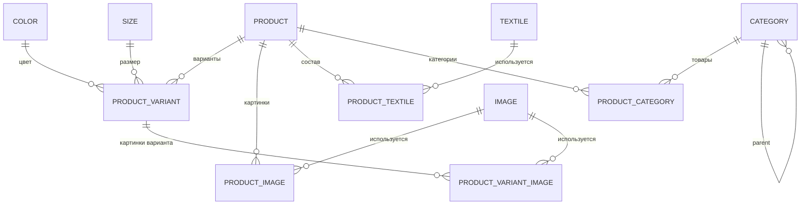

# clothes_store — бэкенд интернет-магазина одежды

REST-сервис для каталога одежды: товары, варианты (цвет + размер), ткани, категории,
изображения, скидки, пользователи и админские CRUD-операции.

Документация:

- [API-справочник](docs/api.md) — все эндпоинты, DTO, коды ошибок, примеры запросов.
- [База данных](docs/database.md) — схема, связи, миграции Flyway.
- [Аудит и исправления](docs/backend-audit.md) — найденные проблемы и принятые решения.

---

## 1. Стек

| Слой | Технология |
|---|---|
| Язык / runtime | Java 26 |
| Фреймворк | Spring Boot 4.1.1 (Web MVC, Security, Data JPA, Validation, Actuator) |
| БД | PostgreSQL 16 |
| Миграции | Flyway |
| Маппинг DTO | MapStruct 1.6.3 |
| Boilerplate | Lombok |
| Тесты | JUnit 5, AssertJ, H2 (PostgreSQL mode) |
| Сборка | Maven 3.9+ |

## 2. Быстрый старт

Нужны JDK 26, Maven 3.9+ и PostgreSQL 16 (или Docker).

```bash
cp .env.example .env          # заполнить DB_URL / DB_USER / DB_PASSWORD
mvn spring-boot:run
```

`.env` подхватывается автоматически (`spring.config.import=optional:file:.env[.properties]`),
поэтому переменные можно не экспортировать вручную.

Для подробных логов и SQL:

```bash
SPRING_PROFILES_ACTIVE=dev mvn spring-boot:run
```

Проверка, что сервис поднялся:

```bash
curl http://localhost:8080/actuator/health
curl http://localhost:8080/api/products
```

### Docker

Полный стек (PostgreSQL + бэкенд + Nuxt-фронтенд) описан в `docker-compose.yml`
родительского каталога:

```bash
docker compose up -d --build
```

Образ бэкенда — многоступенчатый: Maven-кэш зависимостей, non-root пользователь,
healthcheck на `/actuator/health`.

## 3. Конфигурация

Все настройки читаются из переменных окружения (см. `.env.example`):

| Переменная | Обязательна | По умолчанию | Назначение |
|---|---|---|---|
| `DB_URL` | да | — | JDBC URL PostgreSQL |
| `DB_USER` | да | — | пользователь БД |
| `DB_PASSWORD` | да | — | пароль БД |
| `SPRING_PROFILES_ACTIVE` | нет | — | `dev` (SQL + DEBUG) или `prod` (INFO) |
| `APP_STORAGE_LOCATION` | нет | `./uploads` | каталог для загруженных файлов |
| `APP_STORAGE_BASE_URL` | нет | `/files` | префикс URL картинок в ответах API |
| `APP_UPLOAD_MAX_BATCH_SIZE` | нет | `20` | максимум файлов в одном `/api/images/batch` |
| `APP_CORS_ALLOWED_ORIGINS` | нет | `http://localhost:3000` | origin(ы) SPA через запятую |

Профили:

- `application.properties` — общие настройки (JPA, Flyway, лимиты, Actuator).
- `application-dev.properties` — `show-sql`, форматирование SQL, DEBUG для security/web.
- `application-prod.properties` — INFO-логи, `server.forward-headers-strategy=framework`.

Важно: `spring.jpa.open-in-view=false`, `ddl-auto=validate`, размер страницы ограничен 100.

## 4. Структура проекта

```
src/main/java/com/example/clothesstore/
├── auth/          # вход, регистрация, logout, /me (сессии)
├── user/          # пользователи и роли
├── product/       # товары, варианты, связи с тканями/картинками/категориями
│   ├── dto/       # response/request DTO + MapStruct-маппер
│   └── jpa/       # JPA-сущности товарного домена
├── category/      # дерево категорий
├── textile/       # справочник тканей
├── color/         # справочник цветов
├── size/          # справочник размеров (пока без публичного API)
├── image/         # загрузка/хранение/дедупликация изображений
├── config/        # SecurityConfig, StaticResourceConfig
├── exception/     # доменные исключения + GlobalExceptionHandler
└── ClothesStoreApplication.java

src/main/resources/db/migration/   # Flyway V1..V8
src/test/java/...                  # 94 теста (unit + integration + HTTP)
```

Слои: **controller → service → repository**. Контроллеры работают только с DTO,
JPA-сущности не покидают сервисный слой на чтение (кроме простых справочников).
Транзакции — на сервисах; DTO собираются внутри транзакции, поэтому
`open-in-view=false` не приводит к `LazyInitializationException`.

## 5. Доменная модель



Бизнес-инварианты, которые поддерживает сервис:

- у товара не больше одной **главной** картинки (`isMain`), при удалении главной
  назначается первая оставшаяся;
- у товара не больше одной **основной** ткани (`primaryFabric`);
- у товара не больше одной **основной** категории (`isPrimary`), при удалении
  основной назначается первая оставшаяся;
- `discounted_price` не может быть отрицательной или больше `base_price`
  (constraint в БД);
- комбинация `(product, color, size)` и `sku` уникальны → дубликаты дают `409`;
- изображения дедуплицируются по SHA-256: повторная загрузка того же файла
  возвращает существующую запись.

## 6. Изображения

- Хранилище — локальная файловая система (`APP_STORAGE_LOCATION`), отдача через
  `GET /files/{storageKey}` с кэшем 30 дней.
- Ключ объекта — `ГГГГ-ММ-ДД/UUID.ext`, в БД хранится только ключ; публичный URL
  собирается из `APP_STORAGE_BASE_URL`.
- Разрешены **JPEG, PNG, GIF, BMP**; формат проверяется по содержимому (ImageIO),
  а не по клиентскому `Content-Type` — SVG/HTML под видом картинки отклоняются.
- Лимиты: 10 МБ на файл, 50 МБ на запрос, 20 файлов в батче, 40 Мп и 20 000 px
  на сторону.

## 7. Безопасность

- Аутентификация — HTTP-сессия (`JSESSIONID`), пароли — BCrypt (cost 11).
- При логине выполняется смена id сессии (защита от session fixation).
- Роли: `USER` и `ADMIN`. Админ нужен для `/api/admin/**`, `/api/users/**`,
  загрузки/удаления изображений.
- 401/403 отдаются в JSON `{"message": "..."}`.
- CORS настраивается через `APP_CORS_ALLOWED_ORIGINS`, `allowCredentials=true`.
- CSRF отключён (см. ограничения ниже).

Подробная матрица доступа — в [docs/api.md](docs/api.md#аутентификация-и-права).

## 8. Тесты

```bash
mvn test     # 94 теста, H2, Docker и PostgreSQL не нужны
```

Покрытие по слоям:

| Класс | Что проверяет |
|---|---|
| `web/ApiSecurityIntegrationTest` | реальный Tomcat: 401/403, логин/регистрация, 404 vs 500, CORS, лимит страницы, CRUD через API |
| `product/ProductServiceTest` | CRUD, PATCH, варианты, картинки, ткани, конфликты |
| `product/ProductCategoryServiceTest` | привязки категорий и инварианты |
| `category/CategoryServiceTest` | CRUD категорий, дубликаты, not found |
| `user/UserServiceTest` | хеширование пароля, дубликаты email, CRUD |
| `image/ImageServiceTest` | дедупликация, батчи, поддельные картинки |
| `image/LocalImageStorageServiceTest` | файловое хранилище, path traversal |
| `image/ImageMapperTest` | сборка URL |
| `exception/GlobalExceptionHandlerTest` | маппинг исключений в HTTP-коды |

Тесты работают через профиль `test` (`src/test/resources/application-test.properties`):
H2 в режиме PostgreSQL, Flyway отключён, схема создаётся Hibernate.

## 9. Ограничения и план развития

Текущие ограничения (осознанные или известные):

- **Сессии в памяти**: горизонтальное масштабирование требует sticky sessions,
  рестарт разлогинивает всех. Вариант — Spring Session JDBC/Redis или JWT.
- **CSRF отключён** — включать вместе с фронтендом (`X-XSRF-TOKEN`).
- **Нет rate limiting** на `/api/auth/login` и `/api/auth/register`.
- **Нет домена заказов**: корзина, оформление, оплата, резервирование остатков.
  `stockQuantity` пока не уменьшается и не защищён оптимистичной блокировкой.
- **Справочники**: цвета доступны только в админке, размеры — только внутри варианта
  товара; для фильтров витрины нужны публичные `GET /api/colors` и `GET /api/sizes`.
- **Изображения только на диске** (нет S3/CDN, ресайза и фоновой обработки).
- **Ткани без bean-validation** — поля `TextileDto` не размечены constraint-аннотациями.
- **Скидку нельзя снять** через PATCH: `null` означает «не менять»
  (`NullValuePropertyMappingStrategy.IGNORE`).
- **Нет аудита и мягкого удаления**.
