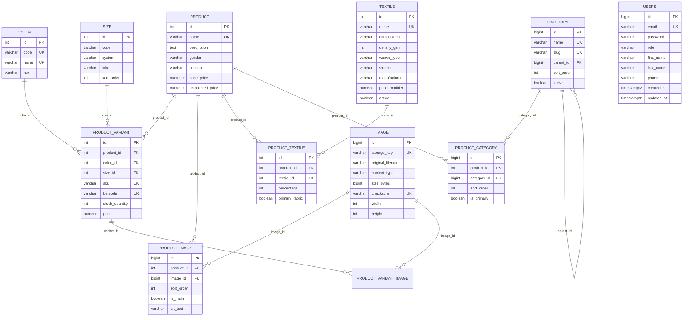

# База данных

СУБД — **PostgreSQL 16**. Схема управляется **Flyway**, приложение работает с
`spring.jpa.hibernate.ddl-auto=validate` (Hibernate только проверяет соответствие
сущностей и схемы, ничего не создаёт и не удаляет).

- Миграции: `src/main/resources/db/migration/V*.sql`
- История применённых миграций: таблица `flyway_schema_history`
- Сиды товаров/тканей/категорий/скидок входят в миграции (V2, V3, V4, V5, V8)

> Правило: **применённые миграции не редактируются**. Любое изменение схемы или данных —
> новая версия `V9__...sql`. Если Flyway ругается на checksum, выполните один раз
> `flyway repair` (см. [ниже](#flyway-repair)).

---

## Схема



---

## Таблицы

### `product`

| Колонка | Тип | Ограничения |
|---|---|---|
| `id` | integer | PK, identity |
| `name` | varchar(255) | unique |
| `description` | text | |
| `gender` | varchar(255) | check `MAN/WOMAN/UNISEX` |
| `season` | varchar(255) | check `SUMMER/WINTER/DEMI_SEASON/ALL_SEASON` |
| `base_price` | numeric(10,2) | |
| `discounted_price` | numeric(10,2) | V7; check `>= 0` и `<= base_price` (constraint `NOT VALID`) |

Индекс: `idx_product_discounted_price` (partial, `WHERE discounted_price IS NOT NULL`) — под
фильтр «товары со скидкой».

### `product_variant`

Уникальность: `sku`, `barcode`, а также `(product_id, color_id, size_id)` **NULLS NOT DISTINCT**
(V6) — вариант без цвета и/или размера тоже не дублируется.
FK на `product` — `ON DELETE CASCADE`. Индексы по `color_id`, `size_id`.

### Связующие таблицы

| Таблица | Уникальность | Каскад |
|---|---|---|
| `product_image` | `(product_id, image_id)` | `product_id` → product |
| `product_variant_image` | `(variant_id, image_id)` | `variant_id` → variant |
| `product_textile` | `(product_id, textile_id)` | `product_id` → product |
| `product_category` | `(product_id, category_id)` | обе FK → `ON DELETE CASCADE` |

Дополнительно проиндексированы `product_textile.textile_id`,
`product_image.image_id`, `product_variant_image.image_id`,
`product_category.category_id`, `category.parent_id` (V6).

### `image`

Метаданные файла: `storage_key` (путь относительно `APP_STORAGE_LOCATION`), `checksum`
(SHA-256, unique — дедупликация), размеры, MIME-тип, `created_at/updated_at`.
Сам файл лежит на диске; в БД только ключ, поэтому базовый URL можно менять без миграции.

### `category`

Дерево категорий через `parent_id` (self-FK). Уникальны `name` и `slug`.
`active` управляет видимостью на витрине: `GET /api/categories` отдаёт только активные.

### `users`

Уникальный `email`, BCrypt-хеш в `password`, роль `USER/ADMIN` с check-констрейнтом,
профильные поля, `created_at/updated_at` заполняются через `@PrePersist/@PreUpdate`.

---

## Миграции

| Версия | Файл | Что делает |
|---|---|---|
| V1 | `V1__init.sql` | базовая схема: product, variant, image, textile, color, size, users + FK |
| V2 | `V2__seed_products_textiles.sql` | 25 тканей и 56 товаров |
| V3 | `V3__seed_images.sql` | 25 записей `image` и привязки `product_image` для товаров 1–6 |
| V4 | `V4__category_table.sql` | таблица `category` + 17 категорий (clothing, outerwear, sale, …) |
| V5 | `V5__product_category.sql` | связь `product_category` + 17 привязок для товаров 1–5 |
| V6 | `V6__indexes_and_variant_uniqueness.sql` | индексы по FK, `UNIQUE NULLS NOT DISTINCT` для варианта |
| V7 | `V7__add_product_discounts.sql` | идемпотентно добавляет `discounted_price`, check-констрейнт, partial index |
| V8 | `V8__seed_product_discounts.sql` | 15 товаров со скидкой (≈ −20%) + привязка к категории `sale` |

Особенности:

- **V3** содержит метаданные картинок, сами файлы ожидаются в каталоге `uploads/`
  (в репозитории он присутствует). Если файлов нет — записи в БД будут, а
  `GET /files/...` вернёт 404.
- **V7** появился потому, что `discounted_price` когда-то дописали прямо в `V1`
  (уже применённую миграцию). V7 использует `ADD COLUMN IF NOT EXISTS` и безопасен
  и там, где колонка уже есть, и там, где её нет.
- **V8** не перезаписывает уже выставленные скидки (`WHERE discounted_price IS NULL`).

---

## Flyway repair

Если при старте появляется:

```
Migration checksum mismatch for migration version 1
```

это значит, что файл `V1__init.sql` менялся после применения. Контрольные суммы нужно
один раз пересчитать, данные при этом не трогаются:

```bash
flyway repair \
  -url=jdbc:postgresql://localhost:5432/oltati \
  -user=oltati_user \
  -password=*** \
  -locations=filesystem:src/main/resources/db/migration
```

После `repair` приложение запустится и применит недостающие миграции (V7/V8).

## Проверка схемы локально

```bash
psql "$DB_URL" -c '\dt'
psql "$DB_URL" -c 'select version, description, success from flyway_schema_history order by installed_rank;'
psql "$DB_URL" -c '\d product'
```

Приложение при старте дополнительно валидирует схему через Hibernate
(`ddl-auto=validate`): если сущность и таблица разошлись — падение на старте с
подробным списком несоответствий.
