# ERD базы данных

Полная ER-диаграмма схемы PostgreSQL (13 таблиц домена). Источник диаграммы —
[`erd.mmd`](erd.mmd), его можно отрендерить во внешних инструментах.

```mermaid
erDiagram
    USERS {
        bigint id PK
        varchar email UK "varchar(100), NOT NULL"
        varchar password "varchar(255), NOT NULL - BCrypt"
        varchar role "varchar(20), NOT NULL, CHECK: USER|ADMIN"
        varchar first_name "varchar(50)"
        varchar last_name "varchar(50)"
        varchar phone "varchar(20)"
        timestamptz created_at "NOT NULL"
        timestamptz updated_at
    }

    PRODUCT {
        int id PK
        varchar name UK "varchar(255)"
        text description
        varchar gender "CHECK: MAN|WOMAN|UNISEX"
        varchar season "CHECK: SUMMER|WINTER|DEMI_SEASON|ALL_SEASON"
        numeric base_price "numeric(10,2)"
        numeric discounted_price "numeric(10,2), CHECK: 0 <= x <= base_price (V7)"
    }

    PRODUCT_VARIANT {
        int id PK
        int product_id FK "product.id, NOT NULL, ON DELETE CASCADE"
        int color_id FK "color.id"
        int size_id FK "size.id"
        varchar sku UK "varchar(50), NOT NULL"
        varchar barcode UK "varchar(50)"
        int stock_quantity "NOT NULL, default 0"
        numeric price "numeric(10,2)"
    }

    PRODUCT_IMAGE {
        bigint id PK
        int product_id FK "product.id, NOT NULL, ON DELETE CASCADE"
        bigint image_id FK "image.id, NOT NULL"
        int sort_order "NOT NULL, default 0"
        boolean is_main "NOT NULL, default false"
        varchar alt_text "varchar(500)"
    }

    PRODUCT_VARIANT_IMAGE {
        bigint id PK
        int variant_id FK "product_variant.id, NOT NULL, ON DELETE CASCADE"
        bigint image_id FK "image.id, NOT NULL"
        int sort_order "NOT NULL"
        boolean is_main "NOT NULL"
        varchar alt_text "varchar(500)"
    }

    PRODUCT_TEXTILE {
        int id PK
        int product_id FK "product.id, NOT NULL, ON DELETE CASCADE"
        int textile_id FK "textile.id, NOT NULL"
        int percentage "0..100"
        boolean primary_fabric
    }

    PRODUCT_CATEGORY {
        bigint id PK
        int product_id FK "product.id, NOT NULL, ON DELETE CASCADE"
        bigint category_id FK "category.id, NOT NULL, ON DELETE CASCADE"
        int sort_order "NOT NULL, default 0"
        boolean is_primary "NOT NULL, default false"
    }

    IMAGE {
        bigint id PK
        varchar storage_key UK "varchar(500), NOT NULL"
        varchar original_filename "varchar(255)"
        varchar content_type "varchar(100), NOT NULL"
        bigint size_bytes "NOT NULL"
        varchar checksum UK "varchar(64) - SHA-256"
        int width
        int height
        varchar alt_text "varchar(500)"
        timestamptz created_at "NOT NULL"
        timestamptz updated_at "NOT NULL"
    }

    COLOR {
        int id PK
        varchar code UK "varchar(20), NOT NULL"
        varchar name UK "varchar(50), NOT NULL"
        varchar hex "varchar(7), #RRGGBB"
    }

    SIZE {
        int id PK
        varchar code "varchar(20), NOT NULL"
        varchar system "varchar(20), NOT NULL, CHECK: LETTER|EU|US|UK|KIDS|SHOES"
        varchar label "varchar(100)"
        int sort_order "NOT NULL"
    }

    TEXTILE {
        int id PK
        varchar name UK "varchar(100), NOT NULL"
        varchar description "varchar(1000)"
        varchar composition "varchar(255)"
        int density_gsm
        varchar weave_type "varchar(30), CHECK: WOVEN|KNITTED|NON_WOVEN|LACE|FELT"
        varchar stretch "varchar(20), CHECK: NONE|LOW|MEDIUM|HIGH"
        varchar manufacturer "varchar(20), CHECK: RUSSIA|CHINA|TURKEY|BELARUS"
        varchar care_instructions "varchar(500)"
        numeric price_modifier "numeric(10,2)"
        boolean active "NOT NULL"
    }

    CATEGORY {
        bigint id PK
        varchar name UK "varchar(100), NOT NULL"
        varchar slug UK "varchar(100), NOT NULL"
        varchar description "varchar(500)"
        bigint parent_id FK "category.id - self reference"
        int sort_order "NOT NULL, default 0"
        boolean active "NOT NULL, default true"
    }

    PRODUCT ||--o{ PRODUCT_VARIANT : "варианты (1:N)"
    PRODUCT ||--o{ PRODUCT_IMAGE : "картинки (1:N)"
    PRODUCT ||--o{ PRODUCT_TEXTILE : "состав (1:N)"
    PRODUCT ||--o{ PRODUCT_CATEGORY : "категории (1:N)"
    PRODUCT_VARIANT ||--o{ PRODUCT_VARIANT_IMAGE : "картинки варианта (1:N)"
    IMAGE ||--o{ PRODUCT_IMAGE : "используется в (1:N)"
    IMAGE ||--o{ PRODUCT_VARIANT_IMAGE : "используется в (1:N)"
    TEXTILE ||--o{ PRODUCT_TEXTILE : "используется в (1:N)"
    COLOR ||--o{ PRODUCT_VARIANT : "цвет (1:N)"
    SIZE ||--o{ PRODUCT_VARIANT : "размер (1:N)"
    CATEGORY ||--o{ PRODUCT_CATEGORY : "товары (1:N)"
    CATEGORY ||--o{ CATEGORY : "дочерние (1:N)"
```



## Обозначения

| Символ | Значение |
|---|---|
| `PK` | первичный ключ |
| `FK` | внешний ключ |
| `UK` | уникальный ключ (в т.ч. составной) |
| `\|\|--o{` | один к нулю-или-многим |
| `\|\|--\|{` | один к одному-или-многим |
| `}o--\|\|` | ноль-или-многие к одному |

Техническая таблица `flyway_schema_history` в ERD не показана — она не относится к домену.

## Назначение таблиц

| Таблица | Назначение |
|---|---|
| `product` | товар: название, цены (в т.ч. скидочная), пол, сезон, описание |
| `product_variant` | конкретная комбинация товара с цветом и размером, SKU, остаток, цена |
| `image` | метаданные загруженного файла (ключ в хранилище, MIME, размеры, SHA-256) |
| `product_image` | галерея товара, порядок и признак главной картинки |
| `product_variant_image` | галерея конкретного варианта (таблица есть, публичного API пока нет) |
| `textile` | справочник тканей: состав, плотность, плетение, растяжимость, уход |
| `product_textile` | состав товара: процент ткани и признак основной |
| `category` | дерево категорий (self-FK `parent_id`), slug для URL, `active` |
| `product_category` | привязка товара к категориям, порядок и признак основной |
| `color` | справочник цветов: код, название, HEX |
| `size` | справочник размеров: код, размерная система, порядок сортировки |
| `users` | пользователи и роли (`USER`/`ADMIN`), пароль в BCrypt |

## Связи и каскады

| Родитель | Дочерняя | FK | Кардинальность | `ON DELETE` |
|---|---|---|---|---|
| `product` | `product_variant` | `product_id` | 1 : N | `CASCADE` |
| `product` | `product_image` | `product_id` | 1 : N | `CASCADE` |
| `product` | `product_textile` | `product_id` | 1 : N | `CASCADE` |
| `product` | `product_category` | `product_id` | 1 : N | `CASCADE` |
| `product_variant` | `product_variant_image` | `variant_id` | 1 : N | `CASCADE` |
| `image` | `product_image` | `image_id` | 1 : N | `RESTRICT` |
| `image` | `product_variant_image` | `image_id` | 1 : N | `RESTRICT` |
| `textile` | `product_textile` | `textile_id` | 1 : N | `RESTRICT` |
| `color` | `product_variant` | `color_id` | 1 : N | `RESTRICT` |
| `size` | `product_variant` | `size_id` | 1 : N | `RESTRICT` |
| `category` | `product_category` | `category_id` | 1 : N | `CASCADE` |
| `category` | `category` | `parent_id` | 1 : N (self) | `RESTRICT` |

Удаление товара каскадно удаляет его варианты, картинки, состав и привязки к категориям.
Удаление цвета/размера/ткани/картинки, которые уже используются, блокируется FK.

## Уникальные ключи

| Таблица | Уникальность |
|---|---|
| `users` | `email` |
| `product` | `name` |
| `product_variant` | `sku`; `barcode`; `(product_id, color_id, size_id)` — **NULLS NOT DISTINCT** (V6) |
| `product_image` | `(product_id, image_id)` |
| `product_variant_image` | `(variant_id, image_id)` |
| `product_textile` | `(product_id, textile_id)` |
| `product_category` | `(product_id, category_id)` |
| `image` | `storage_key`; `checksum` |
| `color` | `code`; `name` |
| `size` | `(system, code)` |
| `textile` | `name` |
| `category` | `name`; `slug` |

## Индексы

Созданы миграцией V6 (PostgreSQL не индексирует FK автоматически):

- `idx_product_textile_textile_id`
- `idx_product_variant_color_id`
- `idx_product_variant_size_id`
- `idx_product_image_image_id`
- `idx_product_variant_image_image_id`
- `idx_product_category_category_id`
- `idx_category_parent_id`

Плюс частичный индекс из V7 под фильтр скидок:

- `idx_product_discounted_price ON product (discounted_price) WHERE discounted_price IS NOT NULL`

## Нюансы, которые видны на схеме

- **`users` не связана FK с остальными таблицами** — домена заказов/корзины пока нет.
- **`image` — общая таблица файлов**: один файл может использоваться и в галерее товара,
  и в галерее варианта; дедупликация по `checksum`.
- **`product_variant` допускает `NULL` в `color_id`/`size_id`** — уникальность
  `(product_id, color_id, size_id)` работает через `NULLS NOT DISTINCT`.
- **`product.name` nullable** (уникальность есть, но несколько `NULL` допустимы).
- **`product.discounted_price`**: check-констрейнт `NOT VALID` — старые строки не проверяются,
  новые `INSERT/UPDATE` проверяются.
- **`product_variant_image`** существует в схеме, но эндпоинтов для неё пока нет.

## Как отрендерить

- **GitHub / GitLab / IntelliJ IDEA** — открыть `erd.md` или `erd.mmd` как Markdown:
  Mermaid рендерится автоматически (в IDEA нужен плагин Mermaid).
- **CLI**:

  ```bash
  npx @mermaid-js/mermaid-cli -i docs/erd.mmd -o docs/erd.svg
  ```

- **Онлайн** — вставить содержимое `erd.mmd` на <https://mermaid.live>.

Полное описание таблиц и миграций — в [database.md](database.md).
